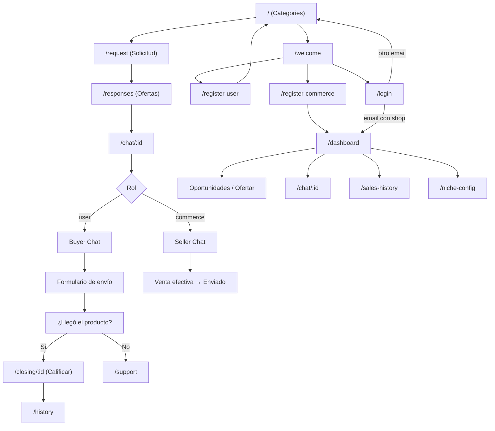

# Documentación Técnica Oficial — Chat de Compras

**Última revisión completa del código:** Noviembre 2026
**Versión de la aplicación:** 0.0.0 (prototipo/MVP, sin backend)
**Autor:** Equipo de Desarrollo Chat de Compras
**Alcance:** Este documento describe el proyecto tal como está implementado hoy, incluyendo lo que funciona, lo que es simulado y la deuda técnica conocida.

---

## 0. Índice

1. [Resumen ejecutivo](#1-resumen-ejecutivo)
2. [Stack tecnológico](#2-stack-tecnológico)
3. [Puesta en marcha](#3-puesta-en-marcha)
4. [Estructura del proyecto](#4-estructura-del-proyecto)
5. [Arquitectura de la aplicación](#5-arquitectura-de-la-aplicación)
6. [Enrutamiento](#6-enrutamiento)
7. [Contextos (estado global)](#7-contextos-estado-global)
8. [Sistema de diseño](#8-sistema-de-diseño)
9. [Componentes compartidos](#9-componentes-compartidos)
10. [Flujos funcionales](#10-flujos-funcionales)
11. [Datos mock y modelo de datos](#11-datos-mock-y-modelo-de-datos)
12. [Estado real de implementación](#12-estado-real-de-implementación)
13. [Deuda técnica y bugs conocidos](#13-deuda-técnica-y-bugs-conocidos)
14. [Convenciones de código](#14-convenciones-de-código)
15. [Guía para extender el proyecto](#15-guía-para-extender-el-proyecto)
16. [Mantenimiento del documento](#16-mantenimiento-del-documento)

---

## 1. Resumen ejecutivo

**Chat de Compras** es un prototipo de marketplace móvil-first centrado en el sector **automotriz** (repuestos, accesorios y servicios). La aplicación simula una conversación de compra-venta en tiempo real entre un **usuario comprador** y un **comercio vendedor**, con un temporizador de 5 minutos para cerrar el acuerdo.

Características principales:

- **Dos roles**: usuario (`user`) y comercio (`commerce`), con navegación y pantallas diferenciadas.
- **Chat simulado**: mensajes, respuestas automáticas, contador regresivo, avisos de sistema, acciones de venta y envío.
- **Flujo de compra**: solicitud automotriz → ofertas → chat → datos de envío → confirmación de entrega → calificación.
- **Flujo de comercio**: panel de oportunidades → ofertar → chat → marcar venta/enviado → estadísticas → configuración de nichos.
- **UI glassmorphism** con paleta neón (menta, azul acero, púrpura profundo) sobre fondo gris claro.
- **Empaquetado móvil** con Capacitor para Android e iOS.

> **Importante:** no existe backend, API, base de datos ni autenticación real. Todos los datos son constantes en memoria o mocks; el usuario se simula en `AuthContext`. El único dato persistente es la sesión simulada en `localStorage` (`chat_compras_session` y `chat_compras_logged_out`).

---

## 2. Stack tecnológico

### 2.1 Núcleo

| Tecnología | Versión | Uso |
|---|---|---|
| React | ^18.3.1 | Librería de UI |
| React DOM | ^18.3.1 | Renderizado |
| React Router DOM | ^6.22.3 | Enrutamiento SPA |
| Vite | ^5.4.1 | Bundler y servidor de desarrollo |
| Tailwind CSS | ^3.4.3 | Estilos utilitarios |
| PostCSS + Autoprefixer | ^8.4.38 / ^10.4.19 | Pipeline CSS |

### 2.2 UI y utilidades

| Dependencia | Uso real en el proyecto |
|---|---|
| `lucide-react` | Iconografía en todas las pantallas |
| `framer-motion` | Animaciones en `Categories.jsx` y `SalesHistory.jsx` |
| `clsx` | Composición condicional de clases (`Button`, `ChatList`, `Orders`) |
| `tailwind-merge` | Resolución de conflictos de clases en `Button` |
| `@emotion/is-prop-valid` | Dependencia indirecta de `framer-motion`; no se importa directamente |

### 2.3 Empaquetado móvil

| Dependencia | Versión |
|---|---|
| `@capacitor/core`, `@capacitor/cli` | ^8.2.0 |
| `@capacitor/android` | ^8.2.0 |
| `@capacitor/ios` | ^8.2.0 |

Configuración en `capacitor.config.json`:

```json
{
  "appId": "com.chatexpress.app",
  "appName": "Chat de Compras",
  "webDir": "dist"
}
```

- Android: `minSdkVersion 24`, `compileSdkVersion 36`, `targetSdkVersion 36`, `versionName "1.0"`.
- iOS: proyecto Xcode en `ios/App`, integración mediante SPM (`CapApp-SPM`).

### 2.4 Scripts de `package.json`

| Script | Comando | Descripción |
|---|---|---|
| `dev` | `vite` | Servidor de desarrollo |
| `build` | `vite build` | Build de producción en `dist/` |
| `lint` | `eslint .` | ESLint 9 con flat config (`eslint.config.js`) |
| `preview` | `vite preview` | Sirve el build |
| `cap:sync` | `npm run build && npx cap sync` | Build + sincronización con Android/iOS |
| `cap:open:android` | `npx cap open android` | Abre Android Studio |
| `cap:open:ios` | `npx cap open ios` | Abre Xcode |

---

## 3. Puesta en marcha

### 3.1 Requisitos

- Node.js 18+ y npm.
- Para móvil: Android Studio (Android) y/o Xcode (iOS, solo macOS).

### 3.2 Desarrollo web

```bash
cd chat-de-compras-main
npm install
npm run dev
```

Vite sirve la app (por defecto en `http://localhost:5173`). La app está limitada visualmente a un ancho de móvil: `max-w-md mx-auto`.

### 3.3 Build y móvil

```bash
npm run build          # genera dist/
npm run cap:sync       # build + copia a android/ios
npm run cap:open:android
npm run cap:open:ios
```

`vite.config.js` define `base: './'`, necesario para que los recursos funcionen dentro del WebView de Capacitor.

### 3.4 Consideraciones offline

Todas las imágenes de producto, avatares y la portada de Categorías son SVG locales en `src/assets/`, por lo que la app carga sin red. Las imágenes que el usuario sube (foto de perfil o domicilio) se muestran como `object URL`/data URL y no dependen de servicios externos. `SafeImage` añade un placeholder local si alguna imagen falla.

---

## 4. Estructura del proyecto

```
chat-de-compras-main/
├── android/                     # Proyecto Android generado por Capacitor
├── ios/                         # Proyecto iOS generado por Capacitor
├── src/
│   ├── assets/                  # Ilustraciones SVG locales (repuestos, avatares, portada)
│   │   ├── repuesto-frenos.svg
│   │   ├── repuesto-bateria.svg
│   │   ├── repuesto-filtro.svg
│   │   ├── repuesto-amortiguador.svg
│   │   ├── repuesto-llanta.svg
│   │   ├── hero-automotriz.svg
│   │   ├── avatar-comercio.svg
│   │   ├── avatar-cliente-1.svg … avatar-cliente-4.svg
│   │   └── image-placeholder.svg
│   ├── main.jsx                 # Punto de entrada: StrictMode + BrowserRouter
│   ├── App.jsx                  # Providers + tabla de rutas + guardas por rol
│   ├── index.css                # Directivas Tailwind + utilidad no-scrollbar
│   ├── theme.config.js          # Tokens de diseño (parcialmente usado)
│   ├── components/
│   │   ├── Logo.jsx             # Burbuja azul + tuerca amarilla, texto "Chat de Compras"
│   │   ├── layout/
│   │   │   ├── UserBottomNav.jsx
│   │   │   └── CommerceBottomNav.jsx
│   │   └── ui/
│   │       ├── Button.jsx       # Botón con variantes y twMerge
│   │       ├── Input.jsx        # Input con label, icono y error
│   │       └── CalendarPopup.jsx# Calendario reutilizable (reconstruido)
│   ├── context/
│   │   ├── AuthContext.jsx      # Sesión mock persistida, login/logout
│   │   └── ChatContext.jsx      # Chat global por conversación, persistido en localStorage
│   └── pages/
│       ├── Welcome.jsx          # Elección de rol
│       ├── auth/                # Login, registro usuario/comercio, recuperación
│       ├── user/                # Flujo del comprador
│       ├── commerce/            # Flujo del vendedor
│       └── common/              # Chats, pedidos, notificaciones, soporte, 404
├── public/
│   └── favicon.svg              # Favicon propio
├── capacitor.config.json
├── index.html
├── package.json
├── postcss.config.js
├── tailwind.config.js
└── vite.config.js
```

---

## 5. Arquitectura de la aplicación

### 5.1 Composición raíz

```
index.html
  └── #root
      └── React.StrictMode
          └── BrowserRouter
              └── App
                  └── AuthProvider
                      └── AppRoutes
                          └── <div class="max-w-md ...">  ← marco móvil
                              └── <Routes> ... </Routes>
```

`src/main.jsx` monta la app con `BrowserRouter`. `src/App.jsx` envuelve todas las rutas en `AuthProvider` y limita el ancho a `max-w-md`.

> `AuthProvider` usa `useNavigate` y `useLocation`, por lo que **debe** estar dentro de `BrowserRouter`. Si se cambia a `HashRouter` o se mueve el provider fuera del router, la app lanza un error.

### 5.2 Patrón de estado

- **Context API** para dos dominios: autenticación y chat.
- **Estado local** (`useState`) en cada página para formularios, modales, filtros y datos mock.
- **Sin store global** (no Redux/Zustand) y **sin caché de datos**.

### 5.3 Chat global y persistente

`ChatProvider` se monta **una sola vez** en `App.jsx`, por encima de las rutas, y administra todas las conversaciones por `chatId`:

```jsx
<AuthProvider>
  <ChatProvider>
    <AppRoutes />
  </ChatProvider>
</AuthProvider>
```

Consecuencias:

- El estado del chat **sobrevive** a la navegación y a una recarga (se persiste en `localStorage`).
- Comprador y comercio **comparten la misma conversación** cuando abren el mismo `chatId`; cada uno ve sus mensajes a la derecha.
- El temporizador descuenta solo la conversación activa y se conserva su avance.
- `openChat(id)` consume el `id` de la URL (`useParams`) y restaura o crea la conversación correspondiente.

### 5.4 Selección de rol en el chat

`src/pages/common/ChatDispatch.jsx` decide qué chat renderizar:

```jsx
const { user } = useAuth();
if (user?.role === 'commerce') return <SellerChat />;
return <BuyerChat />;
```

Como el usuario mock por defecto es `{ role: 'user', name: 'Julia' }`, **siempre se renderiza el chat de comprador** salvo que se inicie sesión con un correo que contenga `"shop"` o se edite el mock.

---

## 6. Enrutamiento

Definido en `src/App.jsx`.

| Ruta | Componente | Archivo | Estado |
|---|---|---|---|
| `/` | `Categories` | `pages/user/Categories.jsx` | Activa (entrada por defecto) |
| `/welcome` | `Welcome` | `pages/Welcome.jsx` | Activa |
| `/login` | `Login` | `pages/auth/Login.jsx` | Activa |
| `/register-user` | `RegisterUser` | `pages/auth/RegisterUser.jsx` | Activa |
| `/register-commerce` | `RegisterCommerce` | `pages/auth/RegisterCommerce.jsx` | Activa |
| `/recover-password` | `RecoverPassword` | `pages/auth/RecoverPassword.jsx` | Activa |
| `/categories` | `Categories` | `pages/user/Categories.jsx` | Activa (duplicada con `/`) |
| `/request` | `RequestForm` | `pages/user/RequestForm.jsx` | Activa |
| `/responses` | `Responses` | `pages/user/Responses.jsx` | Activa |
| `/chat/:id` | `ChatDispatch` | `pages/common/ChatDispatch.jsx` | Activa (elige Buyer/Seller) |
| `/product/:id` | `ProductDetail` | `pages/user/ProductDetail.jsx` | Activa, sin enlaces entrantes |
| `/tracking` | `Tracking` | `pages/user/Tracking.jsx` | Activa, sin enlaces entrantes |
| `/history` | `History` | `pages/user/History.jsx` | Activa (nav usuario) |
| `/closing/:id` | `Closing` | `pages/user/Closing.jsx` | Activa (desde chat comprador) |
| `/profile-user` | `UserProfile` | `pages/user/UserProfile.jsx` | Activa (nav usuario) |
| `/addresses` | `Addresses` | `pages/user/Addresses.jsx` | Activa |
| `/edit-user-profile` | `EditUserProfile` | `pages/user/EditUserProfile.jsx` | Activa |
| `/dashboard` | `Dashboard` | `pages/commerce/Dashboard.jsx` | Activa (nav comercio) |
| `/sales-history` | `SalesHistory` | `pages/commerce/SalesHistory.jsx` | Activa (nav comercio) |
| `/profile` | `Profile` | `pages/commerce/Profile.jsx` | Activa (nav comercio) |
| `/edit-profile` | `EditProfile` | `pages/commerce/EditProfile.jsx` | Activa |
| `/change-password` | `ChangePassword` | `pages/commerce/ChangePassword.jsx` | Activa |
| `/niche-config` | `NicheConfig` | `pages/commerce/NicheConfig.jsx` | Activa (nav comercio) |
| `/notifications` | `Notifications` | `pages/common/Notifications.jsx` | Activa |
| `/orders` | `Orders` | `pages/common/Orders.jsx` | Activa (desde notificaciones) |
| `/chat-list` | `ChatList` | `pages/common/ChatList.jsx` | Activa |
| `/support` | `Support` | `pages/common/Support.jsx` | Activa (desde chat comprador) |
| `*` | `NotFound` | `pages/common/NotFound.jsx` | Activa |

**Archivos sin ruta:**

- Ninguno. `Splash.jsx`, `NicheExploration.jsx` y `CreateAd.jsx` se retiraron del proyecto (respaldo en `%TEMP%\opencode\chat-de-compras-dead-code`).

**Navegación inferior:**

| `UserBottomNav` | Ruta | `CommerceBottomNav` | Ruta |
|---|---|---|---|
| Inicio | `/categories` | Panel | `/dashboard` |
| Mensajes | `/chat-list` | Estadísticas | `/sales-history` |
| Historial | `/history` | Ajustes | `/niche-config` |
| Perfil | `/profile-user` | Perfil | `/profile` |

> `ChatList` siempre usa `UserBottomNav`, incluso si se abre desde el panel de comercio.

---

## 7. Contextos (estado global)

### 7.1 `AuthContext.jsx`

Expone: `{ user, login, logout, setUser }`.

| Elemento | Comportamiento real |
|---|---|
| `user` | Se hidrata desde `localStorage`; primera vez: mock `{ role: 'user', name: 'Julia' }` |
| `checkSession` | Eliminado: la sesión se lee de forma síncrona al iniciar |
| Usuario mock | `{ role: 'user', name: 'Julia' }` por defecto |
| Redirección inicial | `HomeRedirect` envía usuario → `/categories`, comercio → `/dashboard`, sin sesión → `/welcome` |
| `login(role)` | Crea `{ role, name }`, guarda en `chat_compras_session`, limpia `chat_compras_logged_out` y navega a `/categories` o `/dashboard` |
| `logout()` | Borra la sesión, marca `chat_compras_logged_out = 1`, limpia `user` y navega a `/login` |

**Limitaciones:**

- No hay autenticación real ni tokens.
- Las credenciales no se validan: cualquier correo inicia sesión (con `shop` entra como comercio).
- El mock está hardcodeado en el código.

### 7.2 `ChatContext.jsx`

Expone estados, refs y funciones:

| Elemento | Tipo | Descripción |
|---|---|---|
| `activeChatId` | `String` | Chat abierto actualmente (se toma de `useParams` vía `openChat`) |
| `openChat(chatId)` | `Function` | Activa o crea la conversación y limpia modales/entrada |
| `messages` | `Array` | Mensajes del chat activo; `sender`: `buyer`, `seller`, `system` |
| `inputText` / `setInputText` | `String` | Valor del campo de mensaje |
| `timeLeft` | `Number` | Contador del chat activo; inicia en `300` (5 min) |
| `showHistory` / `setShowHistory` | `Boolean` | Modal de reputación del comprador (solo comercio) |
| `showDeliveryOptions` / `setShowDeliveryOptions` | `Boolean` | Pregunta "¿Ya llegó tu producto?" |
| `showShippingForm` / `setShowShippingForm` | `Boolean` | Modal de datos de envío |
| `sellerStep` | `String` | `initial` → `confirmed` → `shipped` (chat activo) |
| `buyerHistory` | `Object` | Rating 4.7, 42 compras, 3 reseñas mock |
| `shippingData` / `setShippingData` | `Object` | Nombre, teléfono, dirección, referencias, foto (base64) |
| `messagesEndRef` | `Ref` | Nodo para autoscroll |
| `formatTime(seconds)` | `Function` | Devuelve `M:SS` |
| `sendMessage(senderRole, autoReplyRole)` | `Function` | Añade mensaje y programa respuesta automática a 2 s |
| `handleSellerAction()` | `Function` | Avanza el flujo del vendedor y añade mensaje de sistema al enviar |
| `handleProductArrivedYes(navigate, chatId)` | `Function` | Navega a `/closing/:id` |
| `handleProductArrivedNo(navigate)` | `Function` | Navega a `/support` |
| `handleShippingSubmit(e)` | `Function` | Cierra el formulario y muestra la pregunta de llegada (500 ms) |
| `handleFileChange(e)` | `Function` | Lee la imagen y la guarda como data URL |
| `scrollToBottom()` | `Function` | `scrollIntoView({ behavior: 'smooth' })` |

**Arquitectura:**

- `ChatProvider` se monta una sola vez en `App.jsx`, por encima de las rutas, así que comprador y comercio comparten la misma conversación.
- Las conversaciones se guardan por `chatId` en `localStorage` (`chat_compras_chats_v1`) mediante un efecto de persistencia.
- `openChat(id)` restaura la conversación existente o crea una nueva con los 3 mensajes de ejemplo.

**Comportamiento del temporizador:**

1. Un único `setInterval` global descuenta solo el `timeLeft` de la conversación activa.
2. Al llegar exactamente a `120` se añade **una vez** el aviso "Necesitas dar respuesta o este chat cerrará en 2 minutos" (flag `warningSent`).
3. Al llegar a 0 se añade **una vez** el mensaje "El tiempo del chat ha terminado..." (flag `closed`) y se deshabilitan input y envío.
4. El temporizador se limpia al desmontar el provider y no afecta a conversaciones inactivas.

**Comportamiento de `sendMessage`:**

- Ignora mensajes vacíos (`trim`) y chats cerrados o sin conversación activa.
- Usa actualizaciones funcionales de estado para no perder mensajes concurrentes.
- Genera IDs con `crypto.randomUUID()` (con fallback) para evitar colisiones.
- Limpia `inputText` y, si recibe `autoReplyRole`, programa a 2 s una respuesta fija en el mismo `chatId`.

**Otros detalles:**

- Mensajes iniciales: 3 mensajes de ejemplo (pastillas de freno para Corolla, transferencia, filtro de regalo).
- `useParams()` se consume en cada pantalla mediante `openChat(id)`.
- `buyerHistory` es estático y no depende del chat.
- La foto del domicilio no se persiste para no agotar la cuota de `localStorage`.

---

## 8. Sistema de diseño

### 8.1 Paleta

Hay **dos sistemas visuales coexistiendo**:

**A. Sistema neón/glassmorphism (mayoría de pantallas nuevas):**

| Token | Hex | Uso |
|---|---|---|
| Fondo base | `#E7E7E7` | Fondo de la app |
| Deep Purple | `#4B227A` | Texto/acento secundario, bordes, badges |
| Steel Blue | `#0197AF` | Acento técnico, iconos, foco |
| Neon Mint | `#00EED0` | CTA, estados activos, glow |
| Glass | `bg-white/70` + `backdrop-blur-md` | Tarjetas y headers |

**B. Sistema legacy (Tailwind `primary` azul):**

Definido en `tailwind.config.js`:

| Token | Hex | Uso |
|---|---|---|
| `primary` | `#2563EB` | Logo, Login, Register*, Support, Orders, Notifications, Input |
| `secondary` | `#10B981` | Poco usado |
| `dark` | `#1F2937` | Texto legacy |
| `light` | `#F3F4F6` | Fondo legacy |

Esto genera inconsistencia visual: el flujo de autenticación y varias pantallas comunes siguen en azul/blanco, mientras el resto usa neón + glass.

### 8.2 `theme.config.js`

Centraliza tokens como clases de Tailwind, pero **la mayoría de las páginas no lo usan** y escriben los hex directamente.

| Export | Contenido |
|---|---|
| `BORDER_RADIUS` | `rounded-lg` … `rounded-[32px]`, `rounded-full` |
| `SHADOWS` | `shadow-sm` … `shadow-xl`, `glow` con `rgba(0,238,208,0.5)` |
| `COLORS` | `primary`, `success`, `warning`, `danger`, `background`, `deepPurple`, `steelBlue`, `neonMint`, `glass` |
| `TRANSITIONS` | `duration-200/300/500` |
| `SPACING` | `p-1.5` … `p-6` |
| `THEME` | `button` (base, primary, secondary, success), `card` (base, glass), `input.base` |

> `THEME.button.secondary` referencia `text-dark`, que existe en Tailwind; `COLORS.primary` apunta a `bg-primary` (azul legacy), no al neón.

### 8.3 Patrones visuales recurrentes

- **Glassmorphism**: `bg-white/70 backdrop-blur-md border border-white/30`.
- **Gradientes**: `from-[#00EED0] to-[#0197AF]`, `from-[#0197AF]/15 to-[#4B227A]/15`.
- **Glow neón**: `shadow-[0_0_20px_rgba(0,238,208,0.5)]`.
- **Botones CTA**: fondo menta, texto negro, `active:scale-95`.
- **Cabeceras sticky** con blur.
- **Modales** a pantalla completa con overlay `bg-black/50`.
- **Animaciones**: clases `animate-in`, `fade-in`, `slide-in-from-bottom-*`, `zoom-in-95` (utilidades tipo `tailwindcss-animate`, **no instaladas**; no tienen efecto real salvo las definidas manualmente). `animate-bounce-subtle` tampoco está definida en la config.

---

## 9. Componentes compartidos

### 9.1 `Button.jsx`

- Props: `children`, `variant`, `fullWidth`, `className`, `...props`.
- Variantes: `primary` (menta + glow), `secondary` (glass), `outline` (borde acero), `ghost`, `danger`.
- Usa `clsx` + `twMerge` para combinar clases.
- Pasa `type` y `disabled` al `<button>`.

### 9.2 `Input.jsx`

- Props: `label`, `error`, `icon`, `className`, `...props`.
- Renderiza label opcional, icono a la izquierda y mensaje de error.
- **Usa el sistema legacy** (`bg-gray-50`, `border-gray-200`, `ring-primary` azul) y no el tema neón.
- No usa `forwardRef`, por lo que no es compatible directamente con librerías que necesiten refs.

### 9.3 `Logo.jsx`

- SVG de burbuja azul (`#2563EB`) con tuerca amarilla (`#FACC15`) y texto "Chat de Compras".
- Tamaños `sm`, `md`, `lg`.
- No refleja la paleta neón actual.

### 9.4 Navegación inferior

- `UserBottomNav` y `CommerceBottomNav`.
- Fijos abajo, `max-w-md mx-auto`, blur, iconos Lucide.
- No usan `<NavLink>`; comparan `location.pathname` manualmente.
- No marcan rutas hijas como activas (p. ej. `/chat/1` no activa "Mensajes").

### 9.5 `CalendarPopup.jsx`

Calendario reutilizable reconstruido: genera la cuadrícula del mes, permite navegar entre meses, seleccionar un día y confirmar la fecha. Se usa como selector de fecha en los formularios que lo requieren.

---

## 10. Flujos funcionales

### 10.1 Diagrama general de navegación



### 10.2 Flujo del comprador (usuario)

1. **Entrada**: `/` muestra `Categories` (pantalla automotriz con imagen y CTA "¿QUÉ NECESITAS?").
2. **Solicitud**: `/request` → `RequestForm`.
   - Permite múltiples productos.
   - Campos por producto: categoría, producto, tipo/marca/modelo de vehículo, años, referencia, marca, condición, cantidad, notas e imágenes.
   - Las imágenes se previsualizan con `URL.createObjectURL` (no se suben a ningún sitio).
   - Al enviar: `console.log` y navegación a `/responses`.
3. **Respuestas**: `/responses` muestra dos ofertas mock (Repuestos del Sur y Frenos y Más) con precio, distancia, tiempo, rating y disponibilidad. "CHATEAR" navega a `/chat/:id`.
4. **Chat comprador**: `BuyerChat` (usa el `ChatProvider` global).
   - Header: nombre del vendedor "Repuestos del Sur", estado "En línea", temporizador.
   - Tarjeta de acuerdo: `$120 • Transferencia • Pendiente`.
   - Mensajes con estilos distintos para comprador, vendedor y sistema; se conservan al recargar.
   - CTA flotante "Confirmar compra" → abre modal de datos de envío.
   - Formulario: nombre, teléfono, calle, interior, colonia, ciudad, referencias y foto (opcional).
   - Al enviar: se cierra el formulario y aparece "¿Ya llegó tu producto?".
   - "Sí" → `/closing/:id`; "No" → `/support`.
5. **Cierre**: `/closing/:id` permite elegir 1–5 estrellas y comentario. "ENVIAR CALIFICACIÓN" navega a `/history` (sin persistir).
6. **Historial**: `/history` lista compras mock completadas.
7. **Perfil**: `/profile-user` con foto (vista previa local), compras/pendientes, accesos a información personal, direcciones, notificaciones y seguridad. `logout` cierra sesión.

### 10.3 Flujo del comercio

1. **Entrada**: `/dashboard` (también se llega tras login/registro de comercio).
2. **Panel**: KPIs mock (ventas, leads, conversión) y oportunidades activas con datos del cliente.
   - "Ver detalles" abre modal con descripción, presupuesto, usuario e imagen ampliable.
   - "OFERTAR AHORA" despliega textarea de cierre + precio; "Enviar oferta" simula éxito durante 2 s (`console.log`).
3. **Chat vendedor**: `SellerChat`.
   - Header: comprador "Juan P.", botón "Historial" (reputación mock) y temporizador.
   - CTA de dos pasos: "VENTA EFECTIVA" (`initial` → `confirmed`) y "YA SALIÓ EL PRODUCTO" (`confirmed` → `shipped`, añade mensaje de sistema).
   - Modal de historial del comprador con rating, compras y reseñas.
4. **Estadísticas**: `/sales-history` con gráfico semanal animado, KPIs, selector semana/mes y lista de transacciones mock.
5. **Configuración**: `/niche-config` con perfil, seguridad y nichos/subcategorías activables (estado local).
6. **Perfil**: `/profile` con datos del negocio, membresía, edición y logout.

### 10.4 Flujo de autenticación

1. `/welcome` ofrece "SOY USUARIO", "SOY COMERCIO" e "Iniciar sesión".
2. Registro de usuario: nombre, correo, contraseña, aceptación de términos → `login('user')`.
3. Registro de comercio: datos del negocio automotriz, tipos de vehículo, categoría, inventario, experiencia y credenciales → `console.log` + `login('commerce')`.
4. Login: si el correo contiene `"shop"` → rol comercio; en caso contrario → rol usuario. No valida contraseña.
5. Recuperar contraseña: simula envío y muestra confirmación.
6. Logout: borra la sesión guardada, marca el cierre explícito y navega a `/login`.

---

## 11. Datos mock y modelo de datos

### 11.1 Dónde viven los datos

| Dato | Ubicación | Persistencia |
|---|---|---|
| Usuario/sesión | `AuthContext` | No (se regenera al recargar) |
| Mensajes, temporizador, envío | `ChatContext` | No (se reinicia al desmontar) |
| Ofertas | `Responses.jsx` (`OFFERS`) | No |
| Oportunidades y KPIs | `Dashboard.jsx` | No |
| Transacciones, días, KPIs | `SalesHistory.jsx` | No |
| Chats | `ChatList.jsx` | No |
| Notificaciones | `Notifications.jsx` | No |
| Pedidos | `Orders.jsx` | No |
| Direcciones | `Addresses.jsx` | No (estado local) |
| Nichos | `NicheConfig.jsx` | No (estado local) |
| Solicitudes | `RequestForm.jsx` | No |
| Anuncios personalizados | `localStorage['custom_ads']` | **Sí**, pero la pantalla es inalcanzable |

### 11.2 Formas de datos relevantes

**Mensaje**

```js
{
  id: number,          // messages.length + 1 o Date.now()
  text: string,
  sender: 'buyer' | 'seller' | 'system',
  time: string         // "10:05 AM" / hora local
}
```

**Datos de envío**

```js
{
  name, phone, street, interior,
  neighborhood, city, references,
  photo: string | null   // data URL base64
}
```

**Historial del comprador**

```js
{
  rating: 4.7,
  totalPurchases: 42,
  reviews: [{ id, seller, comment, stars, date }]
}
```

**Oferta (Responses)**

```js
{
  id, store, price, time, distance, rating,
  availability: {
    found, total,
    items: [{ name, status: 'available' | 'missing' }]
  },
  image, description
}
```

**Oportunidad (Dashboard)**

```js
{
  id, product, user, userImage, rating, transactions,
  time_left, progress, budget, details, image
}
```

### 11.3 Coherencia de dominio

Todos los mocks visibles son automotrices y comparten el mismo universo de tiendas y precios:

- `ChatContext`: pastillas de freno para Corolla, transferencia y filtro de regalo.
- `Responses`: pastillas Bosch y filtro de aceite (Repuestos del Sur / Frenos y Más).
- `Dashboard`: pastillas para Corolla y batería 12V para Civic.
- `SalesHistory`: frenos, batería, filtro de aceite y amortiguadores.
- `History`: pastillas de freno y batería 12V (2026).
- `ProductDetail`: pastillas de freno delanteras con marcas Bosch/TRW/Valeo.
- `Notifications`: promoción de frenos y lubricantes.
- `Orders`: frenos, batería y filtro de aceite.
- `ChatList` / `Tracking`: frenos, batería y amortiguadores.

Las ilustraciones de producto, los avatares y la portada de Categorías son SVG locales en `src/assets/`; la app ya no depende de Unsplash.

---

## 12. Estado real de implementación

### 12.1 Funciona (navegación y UI)

- Navegación completa entre pantallas.
- Formularios con estado local y validación HTML básica.
- Modales, tabs, acordeones, toggles y selector de estrellas.
- Chat con envío, respuestas automáticas, autoscroll y temporizador.
- Selección de rol por `AuthContext`.
- Sesión persistida en `localStorage` y logout selectivo.
- Rutas protegidas por rol (`RequireRole`) y redirección de inicio según sesión.
- Chat global: una sola conversación compartida entre comprador y comercio, con estado por `chatId`.
- Conversaciones persistidas en `localStorage` (`chat_compras_chats_v1`).
- Temporizador con aviso a los 2 minutos y cierre real a los 0 segundos.
- Logout con limpieza de la sesión guardada.
- Validación de formularios críticos (`ChangePassword`, `RequestForm`).
- Build de Vite, ESLint y configuración de Capacitor (Android/iOS presentes).
- `npm run cap:sync` copia el build a Android e iOS correctamente.
- Tests automatizados con Vitest + Testing Library (`npm test`): chat (creación, envío, persistencia y cierre) y guardas de ruta por rol.

### 12.2 Simulado

- Login/registro (sin API, sin validación de credenciales).
- Envío de ofertas del comercio.
- Envío de solicitudes.
- Datos de envío (no se envían ni guardan).
- Calificaciones.
- Notificaciones, pedidos, estadísticas, historial, direcciones y nichos.
- Reputación del comprador.
- Recuperación de contraseña y cambio de contraseña.

### 12.3 No implementado

- Backend/API, base de datos y autenticación real.
- Persistencia en servidor de solicitudes, ofertas, chats y pedidos (los chats solo persisten en el dispositivo).
- Subida real de imágenes.
- Pagos.
- Notificaciones push.
- Tests automatizados.
- Manejo de errores/red.

---

## 13. Deuda técnica y bugs conocidos

Ordenados por impacto. No quedan bugs críticos ni deuda alta de assets/accesibilidad tras la Fase 4.

### 13.1 Altos

1. **Inconsistencia de sistema de diseño.**
   - Conviven el azul legacy (`primary #2563EB`) y el neón (`#00EED0`).
   - `Login`, `Register*`, `Support`, `Orders`, `Notifications`, `NotFound`, `Input` y `Logo` siguen en legacy.
   - `theme.config.js` casi no se usa; los hex están duplicados en las páginas.

2. **Formularios sin validación de negocio completa.**
   - `Addresses` permite borrar la dirección principal sin reasignar.
   - `RegisterCommerce` deshabilita el botón, pero no valida formato de NIT/teléfono.
   - **Acción:** centralizar validaciones por formulario.

### 13.2 Medios

3. **Clases de animación inexistentes.**
   - `animate-in`, `fade-in`, `slide-in-from-*`, `zoom-in-95`, `animate-bounce-subtle` no están definidas (`tailwindcss-animate` no está instalado).
   - El resultado es ausencia de animación, no error.

4. **Datos de gráfico estáticos en `SalesHistory`.**
   - Cambiar semana actualiza la etiqueta, pero no los datos.
   - El toggle "Mes" no cambia el gráfico.
   - El hack de color de KPIs (`kpi.color.replace(...)`) es frágil.

5. **`ProductDetail` y `Tracking` sin enlaces entrantes.**
   - Código muerto o funcionalidad a medio conectar.

6. **`@` alias configurado en Vite pero no usado.**
   - Las importaciones son relativas; no es un error, pero es configuración sin uso.

7. **Logger y comentarios de mantenimiento.**
   - `console.log` y `alert` en producción (`Dashboard`, `RequestForm`, `EditUserProfile`, `ProductDetail`).
   - Comentarios "Junio 2026" repetidos en casi todos los archivos.

8. **Sin estados de carga.**
   - `ErrorBoundary` ya cubre los fallos de render, pero no hay `loading`/`skeleton` porque todavía no hay datos remotos.

### 13.3 Bajos

9. No hay backend; la persistencia de chats es local (`localStorage`), no compartida entre dispositivos.
10. El `appId` nativo (`com.chatexpress.app`) no coincide con la marca visible; se mantiene por compatibilidad con los proyectos Android/iOS.
11. Falta instalar y probar la app en un dispositivo/emulador real (la copia web con `cap:sync` ya funciona).

### 13.4 Contraste (auditoría Fase 4)

| Combinación | Ratio | WCAG AA |
|---|---|---|
| `#006E7A` sobre `#FFFFFF` | 5.98:1 | Sí |
| `#006E7A` sobre `#E7E7E7` | 4.84:1 | Sí |
| `#4B227A` sobre `#FFFFFF` | 11.61:1 | Sí |
| `#1F2937` sobre `#FFFFFF` | 14.68:1 | Sí |
| `#4B5563` (gray-600) sobre `#FFFFFF` | 7.56:1 | Sí |
| `#4B5563` (gray-600) sobre `#E7E7E7` | 6.11:1 | Sí |
| `#4B5563` (gray-600) sobre glass (`#F8F8F8`) | 7.12:1 | Sí |
| `#6B7280` (gray-500) sobre `#FFFFFF` | 4.83:1 | Sí (límite) |
| `#6B7280` (gray-500) sobre `#E7E7E7` | 3.91:1 | No para texto normal |
| `#9CA3AF` (gray-400) sobre `#FFFFFF` | 2.54:1 | No |
| `#15803D` (green-700) sobre `#F0FDF4` | 4.79:1 | Sí |
| `#C2410C` (orange-700) sobre `#FFF7ED` | 4.88:1 | Sí |
| `#B91C1C` (red-700) sobre `#FFFFFF` | 6.47:1 | Sí |
| `#0197AF` sobre `#FFFFFF` | 3.47:1 | Solo texto grande o iconos |
| `#00EED0` sobre `#FFFFFF` | 1.49:1 | No (se reserva para fondos/bordes) |

Se sustituyó el color de textos e iconos que usaban neón o azul acero por `#006E7A`; el neón se mantiene en botones, fondos y bordes. Además, todos los textos secundarios pasaron de `gray-500` a `gray-600`, los textos e iconos que usaban `gray-400` sobre tarjetas claras pasaron a `gray-500` (o `gray-600` cuando están sobre el fondo general), los badges de estado usan `green-700`/`orange-700` y los mensajes de error `red-700`.

---

## 14. Convenciones de código

- **Componentes**: función declarada con `export default function Nombre()` o `const Nombre = () => {}`; ambas se usan.
- **Archivos**: PascalCase para componentes (`ChatList.jsx`), camelCase para utilidades (`theme.config.js`).
- **Rutas**: kebab-case (`/edit-user-profile`, `/sales-history`).
- **Estilos**: Tailwind inline; no hay CSS Modules ni styled-components.
- **Iconos**: `lucide-react`, tamaño `w-4 h-4` a `w-10 h-10`.
- **Estado**: `useState` local; Context solo para auth y chat.
- **Navegación**: `useNavigate()`; no se usan `NavLink` ni loaders de React Router.
- **Idioma**: UI y comentarios en español; nombres de variables/funciones en inglés.
- **Formularios**: inputs controlados con `value` + `onChange`; validación HTML (`required`, `type`).
- **Modales**: condicional `{state && <div className="fixed inset-0 ...">}`.

---

## 15. Guía para extender el proyecto

### 15.1 Añadir una página

1. Crear el archivo en `src/pages/<área>/MiPagina.jsx`.
2. Importarlo en `src/App.jsx`.
3. Añadir `<Route path="/mi-ruta" element={<MiPagina />} />`.
4. Si debe aparecer en la navegación, añadir el ítem en `UserBottomNav` o `CommerceBottomNav`.
5. Reutilizar `Button`, `Input` y las clases glass/neón existentes.

### 15.2 Conectar un backend

Puntos de integración recomendados:

| Dominio | Archivo(s) | Acción |
|---|---|---|
| Auth | `context/AuthContext.jsx` | Sustituir `checkSession`/`login`/`logout` por llamadas reales y persistir token |
| Chats | `context/ChatContext.jsx` | Cargar mensajes por `chatId`, enviar mensajes y suscribirse a tiempo real |
| Solicitudes | `pages/user/RequestForm.jsx` | POST de la solicitud y subida de imágenes |
| Ofertas | `pages/commerce/Dashboard.jsx` | POST de oferta y refresco de oportunidades |
| Envío | `pages/user/Chat.jsx` | POST de `shippingData` |
| Calificaciones | `pages/user/Closing.jsx` | POST de rating/comentario |
| Estadísticas | `pages/commerce/SalesHistory.jsx` | Sustituir `days`, `kpis`, `recentTransactions` por datos remotos |
| Perfiles | `Profile.jsx`, `EditProfile.jsx`, `UserProfile.jsx`, `EditUserProfile.jsx` | GET/PATCH de perfil |
| Direcciones | `pages/user/Addresses.jsx` | CRUD real |
| Nichos | `pages/commerce/NicheConfig.jsx` | GET/PATCH de preferencias |

### 15.3 Chat global y persistente (implementado)

1. `ChatProvider` envuelve `<AppRoutes />` en `App.jsx`.
2. `pages/user/Chat.jsx` y `pages/commerce/Chat.jsx` ya no montan su propio provider; llaman a `openChat(id)`.
3. El estado vive por `chatId` y se persiste en `localStorage`; comprador y comercio comparten la misma conversación.
4. Para llevarlo a un backend: sustituir `loadChats`/el efecto de persistencia por llamadas a la API y mantener la misma interfaz (`openChat`, `sendMessage`, `messages`, `timeLeft`).

### 15.4 Assets locales, accesibilidad y robustez (implementado)

1. Todos los mocks usan SVG locales (`hero-automotriz.svg`, `avatar-comercio.svg`, `avatar-cliente-1…4.svg`, `image-placeholder.svg`).
2. `SafeImage` centraliza el `onError` y evita imágenes rotas.
3. `ErrorBoundary` envuelve las rutas y ofrece reintento sin perder la sesión.
4. Se eliminó `user-scalable=no`; el zoom vuelve a estar disponible.
5. Se añadieron `aria-label`, `aria-current`, `aria-expanded`, `role="switch"` y foco visible a los controles clave.
6. Las filas de `ChatList` y el selector de nichos son operables por teclado.

### 15.5 Unificar el diseño

1. Migrar `Input`, `Logo`, `Login`, `Register*`, `Support`, `Orders`, `Notifications` y `NotFound` a la paleta neón/glass.
2. Reemplazar hex hardcodeados por `theme.config.js` o por tokens de Tailwind (`colors.neon`, `colors.steel`, etc.).
3. Añadir las animaciones que se usan (`animate-in`, `fade-in`, etc.) instalando `tailwindcss-animate` o definiéndolas en `tailwind.config.js`.
4. Definir una única fuente de verdad para radios, sombras y espaciados.

### 15.6 Checklist antes de publicar

- [x] Reparar `CalendarPopup.jsx`.
- [x] Retirar `CreateAd`, `Splash` y `NicheExploration`.
- [x] Configurar ESLint y hacer que `npm run lint` pase sin errores ni warnings.
- [x] Añadir `public/` con favicon propio.
- [x] Reemplazar mocks de tecnología por datos automotrices.
- [x] Implementar persistencia de sesión.
- [x] Añadir rutas protegidas por rol.
- [x] Hacer global y persistente el chat, con cierre real del temporizador.
- [x] Probar build (`npm run build`).
- [x] Sustituir las fotos externas por assets locales y añadir fallback de imagen.
- [x] Revisar accesibilidad básica (zoom, aria-labels, foco y teclado).
- [x] Añadir `ErrorBoundary`.
- [ ] Probar sincronización Capacitor en dispositivo/emulador (la copia web ya funciona con `npm run cap:sync`).
- [x] Añadir tests mínimos de flujos críticos (`npm test`, 8 pruebas).
- [x] Corregir el contraste de textos e iconos neón/azul acero.
- [x] Revisar `text-gray-500` sobre fondos `#E7E7E7`, textos sobre glass y badges de estado.

---

## 16. Mantenimiento del documento

| Fecha | Cambio | Autor |
|---|---|---|
| Junio 2026 | Documentación inicial (ChatContext y theme.config) | Equipo de Desarrollo Chat de Compras |
| Noviembre 2026 | Revisión completa del código: arquitectura, rutas, contextos, flujos, datos mock, deuda técnica y guías | Equipo de Desarrollo Chat de Compras |
| Noviembre 2026 | Fase 1: corrección de flujos, sesión persistente, guardas por rol, validaciones y ESLint | Equipo de Desarrollo Chat de Compras |
| Noviembre 2026 | Fase 2: marca "Chat de Compras", contenido 100% automotriz, SVG locales, favicon y documentación | Equipo de Desarrollo Chat de Compras |
| Noviembre 2026 | Fase 3: chat global, estado por conversación, persistencia local, cierre real del temporizador y respuestas sin pérdidas | Equipo de Desarrollo Chat de Compras |
| Noviembre 2026 | Fase 4: assets locales, `SafeImage`, `ErrorBoundary`, zoom, aria-labels, foco visible y navegación por teclado | Equipo de Desarrollo Chat de Compras |
| Noviembre 2026 | Fase 4b: tests con Vitest/Testing Library, `cap sync` verificado y corrección de contraste de textos | Equipo de Desarrollo Chat de Compras |
| Noviembre 2026 | Fase 4c: contraste AA de textos secundarios, badges de estado y mensajes de error | Equipo de Desarrollo Chat de Compras |

### 16.1 Instrucciones para actualizar

1. Actualiza este documento cuando cambien la arquitectura, las rutas, los contextos o el modelo de datos.
2. Añade una fila a la tabla de mantenimiento con fecha y cambio.
3. Si añades archivos clave, inclúyelos en la estructura (§4) y en el índice si aplica.
4. Si corriges un punto de §13, muévelo a un historial de cambios o elimínalo y anota la corrección.
5. Mantén la documentación alineada con el código: si una pantalla deja de ser mock, actualiza §12.
